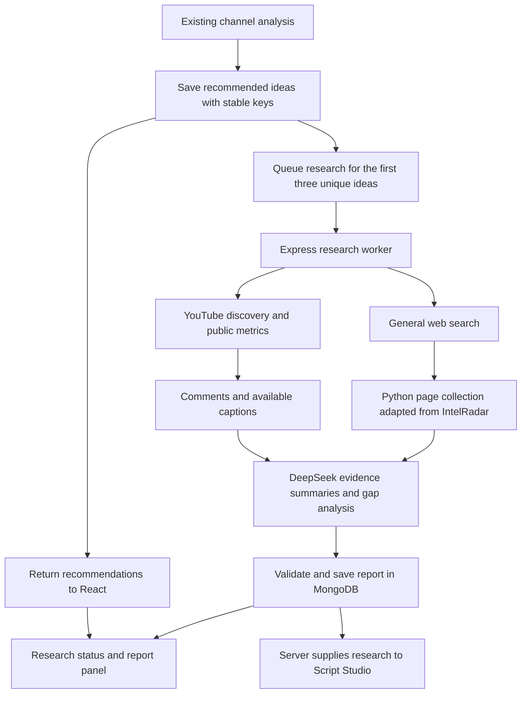

# Competitor research integration plan

Status: implementation added. This document records the design; see README.md and
research_service/README.md for startup and verification. Live-provider evaluation
remains a deployment step. The implementation combines per-video summaries and gap
synthesis in one validated DeepSeek analysis request, following query planning.

## 1. Purpose and user experience

After the app recommends a YouTube video idea, research similar videos and relevant
web content, identify how competitors approach the subject, and suggest a differentiated
angle supported by collected evidence.

Recommendations appear immediately. Research runs in the background, initially for
the first three unique ideas in the displayed recommendation order. Every other idea
has a **Research competitors** action. Reopening Insights reads existing research
rather than starting another scan.

Each idea gains a research status and **View research** action. Its report includes:

- Relevant competing videos and channels, with links and dated public metrics.
- Topics, explanations, examples, formats, and hooks observed in the collected material.
- Recurring questions and complaints in sampled comments.
- Coverage gaps within the examined sample, with supporting evidence and limitations.
- A suggested angle, hook, title options, and outline for this creator's audience.
- Sources, collection times, missing material, and a refresh action.

Example, for illustration only: an idea about AI study tools could become a practical
exam-preparation comparison if examined videos emphasize feature lists while sampled
viewers repeatedly ask for a real study workflow. The report would link those videos
and comments. It would not declare a market-wide gap from that small sample.

## 2. Architecture and IntelRadar reuse

Keep the existing React application, Express authentication, MongoDB, DeepSeek
configuration, and Python transcript service. Add a small Python research collector
on port 8001, avoiding the transcript service's port 8000.

Reuse or adapt IntelRadar's deterministic page capture and readable-text extraction.
Keep source attribution in the extracted module. Leave the imported repository intact
as a reference.

Do not start IntelRadar's entire application: its pipeline imports local Whisper,
uses Gemini, stores shared company profiles in JSON, and analyzes SaaS pricing and
features. Its Next.js UI, desktop shell, licensing routes, monitoring, and notifications
are outside this feature.

The collector uses HTTP extraction first and Playwright for pages requiring rendered
content. It contains no Gemini, Whisper, Hugging Face, or browser-use imports.
DeepSeek performs query planning and analysis in Express; deterministic collectors
fetch the actual content.

## 3. End-to-end research workflow

### A. Resolve the idea and create the job

The backend resolves a saved idea belonging to the authenticated user. It supplies
the idea title, angle, hook, audience, format, channel niche, and language to research.
It does not accept the browser's supplied idea as the authoritative saved record.

Assign stable server-generated idea keys during recommendation generation, retaining
the same key when an idea occurs in both a category list and the combined list.
Use an analysis revision and an idea-content fingerprint to prevent attaching an old
report to a regenerated or edited idea.

Create one MongoDB research record per owner and idea version. Duplicate manual
requests and automatic scheduling return the existing active job or fresh report.
Only enqueue automatic research after channel intelligence has been persisted.
If persistence is unavailable, recommendations still work and research reports its
unavailability. Demo recommendations are not automatically researched.

### B. Discover competing content

Ask DeepSeek for a small validated set of search queries derived from the idea and
audience. Queries contain no invented competitor URLs.

Use the existing YouTube Data API integration to discover competing videos. Start
with up to three searches covering the exact topic, an adjacent audience question,
and recent relevant content. Retrieve video statistics and duration in batches.

Deduplicate results, exclude the creator's own channel, and select up to five videos.
Prefer matching language, audience intent, and format; cap representation at two
videos per channel. Record the queries, filters, and selection reasons. Expand a date
window only within the configured search budget, recording when it was expanded.

Use a configurable general web search adapter, with Brave Search as the proposed
initial provider. Run up to two searches and select up to three relevant pages from
distinct sources where possible. Separate competitor content from factual background
sources. IntelRadar's Google News RSS helper can later add news context; it does not
replace general web discovery.

Brave requires its own search credential. If it is not configured, research can
produce an explicitly partial YouTube-only report. It must not claim that the wider
web was checked.

### C. Collect evidence

For each selected video:

- Store the source URL, title, channel ID, publication date, duration, thumbnail URL,
  available views/likes/comment counts, and observation time.
- Collect up to 25 relevance-ranked and 25 recent top-level comments, deduplicated.
  Record ordering, sample size, comment ID, and a source link.
- Request available captions through the existing transcript service. Preserve
  timestamped segments, language, and whether the material is complete or partial.
- Use descriptions and chapters as additional evidence, identifying them separately
  from the transcript.

For each selected web page, the collector returns the final URL, title, extracted
text, fetch time, publication time when available, and extraction status. Preserve
stable source and excerpt IDs before sending material to DeepSeek.

Apply page-size, transcript-size, total-report-size, and time limits. When material
is truncated or sampled, record its coverage. Missing captions or disabled comments
are missing evidence, not evidence of a content gap.

Public statistics are observations. Views divided by video age may be shown as
**average views per day since publication**, not current growth velocity. Keep
Shorts and long-form comparisons separate. Do not infer competitor CTR, watch time,
retention, or the cause of a video's performance. Thumbnail images can be displayed;
the initial text-based analysis does not claim to evaluate their visual effectiveness.

### D. Analyze with DeepSeek

First produce structured per-video summaries from the available evidence. Summaries
identify covered topics, observed format, viewer questions, and evidence references.
Then synthesize those summaries and relevant web excerpts against the creator's idea.

The final schema contains:

- Competitor overview and a topic coverage matrix.
- Observed audience questions and friction points.
- Potential gaps, evidence references, and a qualitative evidence-strength label.
- A differentiated angle, hook, title options, and outline.
- Limitations, source counts, and collection times.

Require every factual competitor claim to cite a collected source/excerpt. Validate
referenced IDs and URLs against collected records, validate quoted excerpts against
the stored text, and reject invented metrics. A source reference alone does not prove
the reasoning is correct; review claim support in the evaluation dataset as well.

Replace IntelRadar's instruction to fill missing data confidently. Use **not observed
in the examined material** and **insufficient evidence** when appropriate. Separate
observations, interpretations, and creative suggestions.

No unexplained 0–100 opportunity score or LLM-generated accuracy percentage is needed
in the first version. Retain original recommendation scores separately.

As an initial evidence threshold, aim for at least three relevant competitor videos
across two channels and usable content beyond titles for at least two competitors.
Below that threshold, label the report partial and withhold gap conclusions that the
available material cannot support. Each proposed gap needs an explicit comparison
or audience-demand signal; unavailable or truncated content cannot establish absence.

### E. Publish and use the report

Validate the report before saving it. A failed source can result in a partial report
when sufficient usable evidence remains. If no useful evidence is collected, or
DeepSeek cannot produce a valid report, show an error without generating a fabricated
research result.

Keep the original idea and store the proposed refinement in its report. Script Studio
can use the latest valid report to address documented audience needs and differentiate
the outline. It must not reproduce competitor narration.

## 4. Persistence, background processing, and API

Add an `IdeaResearch` MongoDB model with:

| Group | Fields |
| --- | --- |
| Ownership | userId, channelId, intelligenceId/revision, ideaKey |
| Identity | ideaFingerprint, source/query settings, prompt/schema/model versions |
| Job | status, stage, attempts, lease token/expiry, nextAttemptAt, sanitized error |
| Evidence | search queries, selection reasons, sources/excerpts, public metrics, coverage, collection failures |
| Report | competitor summaries, coverage matrix, gaps, refined angle/hook/outline, limitations |
| Freshness | createdAt, startedAt, completedAt, refreshedAt, expiresAt |
| Usage | provider calls, returned token usage, elapsed time |

Use an indexed owner/idea-version lookup and idempotent scheduling. Store bounded
evidence excerpts rather than audio, full browser captures, or unlimited page bodies.

Run a dedicated Node worker process using the same backend code and MongoDB. The
worker atomically leases queued jobs, renews its lease, and reclaims expired work
after a crash. A lease/version check prevents an old worker overwriting a refreshed
report. Start with one active research job and two concurrent source collections.
Redis is unnecessary for the initial deployment.

Statuses: `queued`, `running`, `completed`, `partial`, `failed`.
Stages: `planning`, `discovering`, `collecting`, `analyzing`, `saving`.
Staleness is derived from expiry, not represented as a successful fresh scan.

Proposed authenticated endpoints:

| Endpoint | Behavior |
| --- | --- |
| POST /api/idea-research | Resolve saved idea and enqueue; return 202 for pending work or 200 for a fresh cached report |
| GET /api/idea-research/:id | Return an owned job's progress and available report |
| GET /api/idea-research?intelligenceId=... | Fetch owned statuses in one request for recommendation cards |
| POST /api/idea-research/:id/refresh | Queue a bounded refresh; preserve the last valid report while working |

Reuse the existing `protect` middleware and verify ownership on every route.
The Python collector exposes a narrowly scoped internal collection endpoint guarded
by a server-to-server token. Google, Brave, and DeepSeek credentials remain in Express.

## 5. Frontend and Script Studio integration

Extend the idea cards in `frontend/src/pages/Insights.jsx` with status, **Research
competitors**, and **View research**. Add a report panel with competitor comparisons,
viewer needs, gaps, proposed direction, and sources. Show sample size, last checked
time, and unavailable evidence. Poll active jobs with backoff and stop after completion
or unmount; fetch all visible statuses together.

Add a research API service and hook instead of placing request orchestration in the
card. Page navigation or a browser reload must recover the same persisted jobs.
Other recommendations and script writing remain usable during research.

Update both Script Studio entry points: `pages/ScriptStudio.jsx` and
`components/insights/ScriptStudioModal.jsx`. Preserve idea and research references
in saved script sessions, including follow-up requests that currently send only a
title.

In `handleScriptStudioChat`, resolve research by the authenticated user's stored
references. Supply bounded, source-linked findings to `chatScriptStudio` on initial
generation and later edits. Do not trust browser-submitted research text as verified
evidence. If research finishes after a draft was created, show **Update with research**
so the creator can deliberately revise the current draft.

## 6. Limits and failure behavior

Initial proposed defaults:

| Setting | Default |
| --- | --- |
| Automatic research | First three unique persisted recommendations; other ideas on demand |
| YouTube searches | Up to three per idea |
| General web searches | Up to two per idea |
| Competitor videos | Up to five, maximum two per channel |
| Web pages | Up to three |
| Comment sample | Up to 50 deduplicated comments per video |
| Worker concurrency | One research job, two source collections |
| Research freshness | 24 hours, followed by an explicit refresh |
| Job deadline | Five minutes, configurable; no completion-time guarantee |

Bound total provider calls, prompt sizes, collection bytes, retries, and per-user
daily jobs. Track actual usage. Use exponential backoff for transient provider
failures and quota exhaustion; do not repeatedly retry invalid credentials.
Interrupted jobs must recover or fail visibly.

Treat collected pages and comments as untrusted input. The collector accepts public
HTTP(S) destinations only, rejects private/local destinations and unsafe schemes,
revalidates redirects and resolved addresses, and applies network egress restrictions.
Downloaded text cannot instruct DeepSeek to use tools, reveal credentials, or change
the analysis task.

A failed research job never blocks the existing recommendation response. A partial
scan and an older cached report are labeled explicitly. Missing API credentials are
configuration errors, and missing data is never replaced with demo evidence.

## 7. Implementation sequence and completion checks

| Phase | Work | Completion check |
| --- | --- | --- |
| 1. Contracts and jobs | Idea keys/revisions, IdeaResearch model, authenticated routes, worker leases, limits | Duplicate requests share work; ownership enforced; jobs survive restart |
| 2. Discovery | Query planner, YouTube candidate selection, Brave adapter, search cache | Real linked competitors are relevant, diverse, and exclude the creator |
| 3. Collection | Adapt IntelRadar collectors; integrate captions, comments, source registry | Every evidence item has provenance and coverage; failed fetches are retained as failures |
| 4. DeepSeek research | Evidence summaries, gap report, schema/source validation | Findings refer to collected evidence and handle insufficient data honestly |
| 5. Product integration | Insights statuses/report panel, both Studio entry points, session references | Research appears without delaying recommendations and informs subsequent scripts |
| 6. Evaluation and release | Automated failure tests, live pilot, setup documentation | Complete idea → research → report → script flow works with real sources |

Test edited/regenerated ideas, duplicate category representations, unauthorized report
access, duplicate scheduling, worker restart/lease expiry, cache refresh, API limits,
missing credentials, unavailable captions, disabled comments, partial web failure,
malformed model JSON, unknown source IDs, false quotes, and hostile page instructions.

Run automated tests using fixtures and mocked providers. Then run a small live pilot
across several topics, manually checking competitor relevance, claim support, gap
usefulness, and script differentiation. Record time and provider usage. Establish a
repeatable labeled evaluation set before making numeric accuracy claims.

## 8. Proposed file map and configuration

New backend files:

- `backend/models/IdeaResearch.js`
- `backend/controllers/ideaResearchController.js`
- `backend/routes/ideaResearchRoutes.js`
- `backend/services/research/{discovery,evidence,analysis,queue}.js`
- `backend/services/research/webSearchProvider.js`
- `backend/workers/ideaResearchWorker.js`
- Focused research tests in `backend/test/`.

New frontend files:

- `frontend/src/services/ideaResearchService.js`
- `frontend/src/hooks/useIdeaResearch.js`
- `frontend/src/components/insights/CompetitorResearchPanel.jsx`

New collector:

- `research_service/main.py`, `collectors.py`, `requirements.txt`, `README.md`,
  and IntelRadar attribution.
- Dependencies scoped to FastAPI, HTTP fetching, readable-text extraction, and
  Playwright. No local inference model or second AI provider.

Modify `backend/index.js`, recommendation persistence in `youtubeController.js`
and `ChannelIntelligence.js`, `deepseekService.js`, `Insights.jsx`, both Studio
entry points, and the Studio API client. Keep research lifecycle outside the already
large YouTube controller.

Configuration: existing `DEEPSEEK_API_KEY`, `DEEPSEEK_MODEL`, `YOUTUBE_API_KEY`,
MongoDB and transcript settings; new `BRAVE_SEARCH_API_KEY`,
`RESEARCH_SERVICE_URL=http://127.0.0.1:8001`, `RESEARCH_SERVICE_TOKEN`, worker
limits, automatic-idea count, freshness, and per-user budgets.

## 9. Verified external constraints

- YouTube search provides query/date/format filters. Search is quota-limited, so
  requests must be capped, cached, and accounted for using current project quotas:
  [search.list](https://developers.google.com/youtube/data/reference/rest/v3/search/list).
- Comment threads support recent/relevance ordering and plain-text output:
  [commentThreads.list](https://developers.google.com/youtube/data/reference/rest/v3/commentThreads/list).
- The official captions download endpoint requires permission to edit the video.
  Competitor captions therefore cannot be assumed available through the creator's
  OAuth connection. The existing transcript service is best effort:
  [captions.download](https://developers.google.com/youtube/data/reference/rest/v3/captions/download).
- Brave web search returns linked search results and requires a server-side search
  credential:
  [Brave web search](https://api-dashboard.search.brave.com/app/documentation/web-search/codes),
  [authentication](https://api-dashboard.search.brave.com/documentation/guides/authentication).
